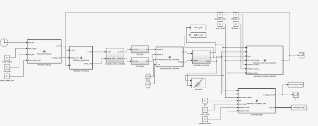

# Autonomous Vacuum Cleaner Robot Simulation

**Course:** ANNEE 4 - INDUSTRY AND ROBOTICS (MOBILE ROBOTICS)  
**Institution:** École Supérieure d'Ingénieurs Léonard de Vinci (ESILV)  
**Authors:** Bollu Shubham N., Athul Thekkinkattil  
**Instructor:** Laurent DELALE  
**Date:** November 06, 2025  

## Abstract

This report presents the design, implementation, and evaluation of an autonomous vacuum cleaner robot utilizing hybrid control architecture. The system combines a global spiral trajectory planner with a reactive obstacle avoidance mechanism to maximize cleaning efficiency in unknown environments. Simulation results demonstrate effective area coverage with approximately 33-40% room coverage achieved within 1000 seconds of operation in a $20\text{m} \times 20\text{m}$ environment containing obstacles.

---

## 1. Introduction

### 1.1 Project Objective
The primary objective of this project is to develop and simulate an autonomous mobile robot capable of efficiently cleaning an unknown indoor environment. The robot must maximize forward movement while avoiding obstacles and ensuring comprehensive area coverage without requiring complex mapping systems such as Simultaneous Localization and Mapping (SLAM).

### 1.2 System Overview
The proposed system employs a differential drive robot modeled as a unicycle kinematic system. The control architecture integrates:
* A global path planning strategy based on Archimedean spiral trajectories
* A local reactive obstacle avoidance system using ultrasonic distance sensing
* Dynamic motor modeling with asymmetric characteristics to simulate real-world conditions
* Grid-based coverage mapping for performance evaluation

---

## 2. Proposed Control Strategy

The control strategy is designed as a hierarchical architecture with two complementary layers: global trajectory planning and local reactive control.

### 2.1 Global Strategy: Archimedean Spiral Trajectory
To maximize area coverage in an unknown environment, we implement a space-filling curve approach using an Archimedean spiral pattern. This strategy ensures systematic outward expansion from a starting point, providing complete coverage in obstacle-free regions.

#### Trajectory Generation
The control inputs are generated according to the following mathematical formulation:

**Linear Velocity:** The commanded linear velocity is maintained constantly to ensure consistent cleaning speed and predictable coverage rates.
$$v_{cmd} = v_{ref\_const} = 0.2 \text{ m/s}$$

**Radius of Curvature:** The spiral (zigzag) radius increases linearly with time, causing the trajectory to expand outward.
$$R(t) = R_0 + k_R \cdot t$$
where:
* $R_0 = 1.0 \text{ m}$ is the initial radius
* $k_R = 0.05$ is the spiral expansion rate gain

**Angular Velocity:** Calculated to maintain the fundamental relationship between linear velocity, angular velocity, and radius of curvature ($v = \omega \cdot R$).
$$\omega_{cmd}(t) = \frac{v_{cmd}}{R(t)} = \frac{v_{ref\_const}}{R_0 + k_R \cdot t}$$

### 2.2 Local Strategy: Reactive Obstacle Avoidance
A reactive control layer continuously monitors sensor data and overrides the global spiral trajectory when obstacles are detected. 

#### State Machine Architecture
Reactive behavior is implemented using a finite state machine with three distinct operational states, determined by the measured distance $d$ from the ultrasonic sensor:

| State | Condition | Control Action |
| :--- | :--- | :--- |
| **Normal Operation** | $d > 1.0 \text{ m}$ | Follow spiral trajectory. Reset internal turn direction state. |
| **Warning Zone** | $0.4 \text{ m} < d \le 1.0 \text{ m}$ | Soft avoidance: Reduce speed to $0.8 \times v_{cmd}$ and initiate soft turn ($\omega = 0.6 \text{ rad/s}$). |
| **Critical Zone** | $d \le 0.4 \text{ m}$ | Hard avoidance: Reduce speed to $0.6 \times v_{cmd}$ and execute sharp turn ($\omega = 1.5 \text{ rad/s}$). |

#### Turn Direction Logic
Upon initial obstacle detection, the system randomly selects either a left or right turn direction and maintains this choice until the obstacle is successfully cleared.

---

## 3. Simulation Architecture

The complete system is implemented in MATLAB/Simulink using a modular block-based architecture.

### 3.1 Kinematic Model
The robot is modeled using differential drive kinematics.
**Wheel Velocity to Robot Velocity Transformation:**
$$v = \frac{R_w}{2}(\omega_R + \omega_L)$$
$$\omega = \frac{R_w}{L_{ax}}(\omega_R - \omega_L)$$
*(Where $R_w = 0.05 \text{ m}$ is wheel radius, $L_{ax} = 0.2 \text{ m}$ is axle track)*

**Global Position Update:**
$$\dot{x} = v \cos(\theta)$$
$$\dot{y} = v \sin(\theta)$$
$$\dot{\theta} = \omega$$

### 3.2 Dynamic Motor Model
To achieve realistic simulation behavior, we model the DC motors driving each wheel with electrical and mechanical dynamics. The two motors are assigned slightly different back-EMF constants (Right: $K_{ed} = 1.2$, Left: $K_{eg} = 1.0$) to simulate real-world asymmetry. Two independent PID controllers compensate for this.

---

## 4. Simulation Results and Analysis

The simulation was executed for a total duration of $T = 1000$ seconds.

### 4.1 Trajectory Analysis
The robot successfully executes the spiral trajectory pattern, beginning from a randomly selected starting position and expanding outward systematically. 

### 4.2 Cleaning Coverage & Combined Visualization
A grid-based occupancy approach quantifies cleaning performance. The workspace is discretized into a $100 \times 100$ uniform grid, where each cell represents a $0.2\text{m} \times 0.2\text{m}$ area. 

The combined visualization below overlays the robot's path on the coverage map, clearly illustrating the correlation between trajectory execution and area cleaning. Key observations include high coverage density in the center, uncleaned regions surrounding the obstacle, and reduced coverage efficiency near corners.

### 4.3 Performance Metrics
The temporal evolution of coverage percentage exhibits two distinct phases: a linear growth phase (0-400s) and a diminishing returns phase (400-1000s) as it frequently encounters walls and obstacles.

| Metric | Value |
| :--- | :--- |
| Simulation Duration | 1000 s |
| Final Coverage Percentage | 33-40% |
| Average Linear Velocity | $0.2 \text{ m/s}$ |
| Total Distance Traveled | ~200 m |

---

## 5. Implementation Instructions

### 5.1 System Requirements
* MATLAB Version: R2020a or newer
* Required Toolboxes: Simulink, Stateflow
* Operating System: Windows, macOS, or Linux

### 5.2 File Structure

* `ZigzagRobot.slx` - Main Simulink model file
* `ZigZag_robot_simulation.m` - MATLAB initialization and execution script

### 5.3 Execution Procedure
1. Extract the provided archive to a local directory.
2. Open MATLAB and navigate to the extracted folder.
3. Open the script `ZigZag_robot_simulation.m` in the MATLAB Editor.
4. Execute the script by pressing F5 or clicking the "Run" button.

**Important:** Do not open or run the Simulink model file directly. The MATLAB script initializes essential workspace variables that the Simulink model requires.

### 5.4 Parameter Modification
You can customize the simulation in `ZigZag_robot_simulation.m`:

| Parameter | Default | Effect |
| :--- | :--- | :--- |
| `v_ref_const` | 0.2 | Robot linear velocity (cleaning speed) |
| `obs_center` | [3, 3] | Obstacle position coordinates |
| `room_length` | 20 | Room dimensions (square room) |
| `k_R` | 0.05 | Spiral expansion rate |
| `R_0` | 1.0 | Initial spiral radius |

---

## 6. Discussion & Future Improvements

**Advantages:**
* **Simplicity:** Minimal computational resources and no map building.
* **Predictability:** Deterministic spiral pattern ensures systematic coverage.
* **Robustness:** Reactive layer provides reliable collision avoidance.

**Future Enhancements:**
1. **Hybrid Coverage Pattern:** Combine spiral for central areas with wall-following for perimeter coverage.
2. **Memory Integration:** Maintain a simple visited cells map to avoid redundant coverage.
3. **Dynamic Velocity Adaptation:** Reduce speed in cluttered regions, increase in open areas.
4. **Multi-Sensor Fusion:** Integrate side sensors for improved spatial awareness.

## 7. Conclusion
This project successfully demonstrates the design and simulation of an autonomous vacuum cleaning robot. The modular Simulink implementation incorporates realistic motor dynamics and provides a solid foundation for further development toward practical autonomous cleaning applications.
