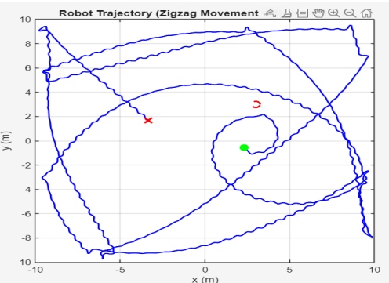
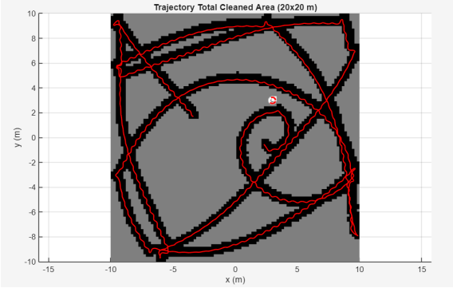

# Autonomous Vacuum Cleaner Robot Simulation

**Course:** ANNEE 4 - INDUSTRY AND ROBOTICS (MOBILE ROBOTICS)  
**Institution:** École Supérieure d'Ingénieurs Léonard de Vinci (ESILV)  
**Authors:** Bollu Shubham N., Athul Thekkinkattil  
**Instructor:** Laurent DELALE  
**Date:** November 06, 2025  

---

## Abstract
This report presents the design, implementation, and evaluation of an autonomous vacuum cleaner robot utilizing hybrid control architecture. The system combines a global spiral trajectory planner with a reactive obstacle avoidance mechanism to maximize cleaning efficiency in unknown environments. Simulation results demonstrate effective area coverage with approximately 33-40% room coverage achieved within 1000 seconds of operation in a $20m \times 20m$ environment containing obstacles.

---

## 1. Introduction

### 1.1 Project Objective
The primary objective of this project is to develop and simulate an autonomous mobile robot capable of efficiently cleaning an unknown indoor environment. The robot must maximize forward movement while avoiding obstacles and ensuring comprehensive area coverage without requiring complex mapping systems such as Simultaneous Localization and Mapping (SLAM).

### 1.2 System Overview
The proposed system employs a differential drive robot modeled as a unicycle kinematic system. The control architecture integrates:
*   A global path planning strategy based on Archimedean spiral trajectories
*   A local reactive obstacle avoidance system using ultrasonic distance sensing
*   Dynamic motor modeling with asymmetric characteristics to simulate real-world conditions
*   Grid-based coverage mapping for performance evaluation

---

## 2. Proposed Control Strategy
The control strategy is designed as a hierarchical architecture with two complementary layers: global trajectory planning and local reactive control.

### 2.1 Global Strategy: Archimedean Spiral Trajectory
To maximize area coverage in an unknown environment, we implement a space-filling curve approach using an Archimedean spiral pattern. This strategy ensures systematic outward expansion from a starting point, providing complete coverage in obstacle-free regions.

**Trajectory Generation**
The control inputs are generated according to the following mathematical formulation:

*   **Linear Velocity:** The commanded linear velocity is maintained constantly to ensure consistent cleaning speed and predictable coverage rates.
    $$v_{cmd} = v_{ref\_const} = 0.2~m/s$$
*   **Radius of Curvature:** The spiral (zigzag) radius increases linearly with time, causing the trajectory to expand outward.
    $$R(t) = R_0 + k_R \cdot t$$
    *(where $R_0 = 1.0~m$ is the initial radius and $k_R = 0.05$ is the spiral expansion rate gain)*
*   **Angular Velocity:** Calculated to maintain the fundamental relationship between linear velocity, angular velocity, and radius of curvature $(v = \omega \cdot R)$.
    $$\omega_{cmd}(t) = \frac{v_{cmd}}{R(t)} = \frac{v_{ref\_const}}{R_0 + k_R \cdot t}$$

### 2.2 Local Strategy: Reactive Obstacle Avoidance
A reactive control layer continuously monitors sensor data and overrides the global spiral trajectory when obstacles are detected, ensuring collision-free navigation. 

**State Machine Architecture**
Based on measured distance $d$ from the ultrasonic sensor:
*   **Normal Operation ($d > 1.0~m$):** Follow spiral trajectory. Reset internal turn direction state.
*   **Warning Zone ($0.4~m < d \le 1.0~m$):** Soft avoidance: Reduce speed to $0.8 \times v_{cmd}$ and initiate soft turn ($\omega = 0.6~rad/s$).
*   **Critical Zone ($d \le 0.4~m$):** Hard avoidance: Reduce speed to $0.6 \times v_{cmd}$ and execute sharp turn ($\omega = 1.5~rad/s$).

---

## 3. Simulation Architecture
The complete system is implemented in MATLAB/Simulink using a modular block-based architecture. The primary model file integrates several subsystems representing different aspects of robot dynamics, sensing, and control.

)

### 3.1 Kinematic Model
The relationship between individual wheel angular velocities and the robot's center linear and angular velocities is given by:
$$v = \frac{R_w}{2}(\omega_R + \omega_L)$$
$$\omega = \frac{R_w}{L_{ax}}(\omega_R - \omega_L)$$
*(where $R_w = 0.05~m$ is the wheel radius, $L_{ax} = 0.2~m$ is the axle track, and $\omega_R, \omega_L$ are the right and left wheel angular velocities)*

The robot's global pose $(x, y, \theta)$ is updated using:
$$\dot{x} = v\cos(\theta)$$
$$\dot{y} = v\sin(\theta)$$
$$\dot{\theta} = \omega$$

### 3.2 Dynamic Motor Model
To achieve realistic simulation behavior, we model the DC motors with electrical and mechanical dynamics, assigning slightly different back-EMF constants (Right: $K_{ed} = 1.2$, Left: $K_{eg} = 1.0$). Two independent PID controllers ($K_p = 10, K_i = 50, K_d = 0$) compensate for these asymmetries.

---

## 4. Simulation Results and Analysis
The simulation was executed for a total duration of $T = 1000$ seconds.

### 4.1 Trajectory Analysis
The robot successfully executes the spiral trajectory pattern, expanding outward systematically. Wall-following behavior and reactive deviations are evident when encountering the obstacle.

### 4.2 Cleaning Coverage & Combined Visualization
The grid-based occupancy approach tracks the $0.4~m$ cleaning radius. The combined visualization below overlays the robot's path on the coverage map, illustrating the correlation between trajectory execution and area cleaning. 

**Performance Metrics:**
*   **Simulation Duration:** $1000~s$
*   **Final Coverage Percentage:** $33-40\%$
*   **Average Linear Velocity:** $0.2~m/s$
*   **Total Distance Traveled:** $\sim 200~m$

---

## 5. Implementation Instructions

### 5.1 System Requirements
*   **MATLAB Version:** R2020a or newer
*   **Required Toolboxes:** Simulink, Stateflow
*   **Operating System:** Windows, macOS, or Linux

### 5.2 File Structure

### 5.3 Execution Procedure
1. Extract the provided archive to a local directory.
2. Open MATLAB and navigate to the extracted folder.
3. Open `ZigZag_robot_simulation.m` in the MATLAB Editor.
4. Execute the script by pressing `F5` or clicking "Run".

**Important:** Do not open or run the `.slx` model directly. The MATLAB script must be run first to initialize essential workspace variables (e.g., `obs_center`, `k_R`, `Kp_w`).

---

## 6. Discussion & Future Improvements
The hybrid control architecture demonstrates simplicity, predictability, and robustness without requiring map building. However, coverage efficiency (33-40%) could be improved, particularly in corners. 

**Proposed Enhancements:**
1.  **Hybrid Coverage Pattern:** Combine spiral for central areas with wall-following for perimeters.
2.  **Memory Integration:** Maintain a simple visited-cells map to avoid redundant coverage.
3.  **Dynamic Velocity Adaptation:** Reduce speed in cluttered regions, increase in open areas.
4.  **Multi-Sensor Fusion:** Integrate side sensors for improved spatial awareness.

---

## 7. Conclusion
This project successfully demonstrates the design and simulation of an autonomous vacuum cleaning robot. The Archimedean spiral trajectory planner provides systematic area coverage, while the reactive obstacle avoidance layer ensures safe navigation. The system provides a solid foundation for further development toward practical autonomous cleaning applications.
